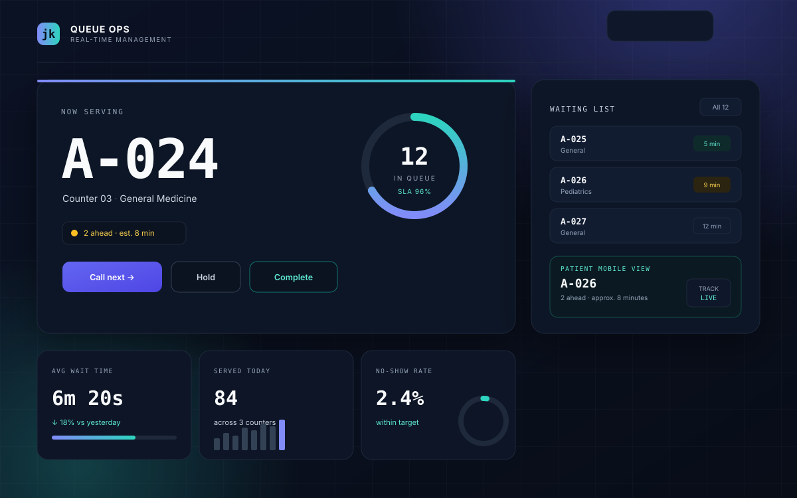

# Jeeradate — jk.dev Portfolio

A clean, fast, single-page developer portfolio for **Jeeradate (jk.dev)** — Industrial & Systems Engineer turned Full-Stack Python & Automation Developer.

Built as a **zero-build static site** with semantic HTML5, Tailwind CSS (Play CDN), and a small amount of vanilla JavaScript. Ready to publish on GitHub Pages.

- **Live site:** https://jeeradate.github.io/
- **Fastwork:** https://fastwork.com/user/jk.dev
- **GitHub:** https://github.com/jeeradate

---

## Highlights

- **Dark-first design** with a persistent light-mode toggle (`localStorage`)
- **Fully responsive** layout from 360 px phones to wide desktops
- **Thai + English typography** — `Prompt` for Thai, `Inter` for Latin, `JetBrains Mono` for code
- **Sticky navigation** with mobile menu, active-section highlighting, and scroll progress bar
- **Featured projects** in a Problem → Solution format with tech badges and links
- **Screenshot placeholders** included as custom SVG UI mockups
- **Copy-to-clipboard** buttons for email and LINE ID
- **Accessibility-minded**: skip link, focus styles, ARIA labels, reduced-motion support
- **SEO ready**: meta description, Open Graph, Twitter card, canonical URL, JSON-LD `Person` schema, SVG favicon
- **No npm, no build step** — just `index.html` and assets

---

## Project structure

```text
.
├── index.html                  # The entire site (HTML + CSS + JS)
├── README.md
└── assets/
    └── images/
        ├── favicon.svg
        ├── queue-preview.svg       # Placeholder for project 1
        ├── spapp-preview.svg       # Placeholder for project 2
        ├── hotstring-preview.svg   # Placeholder for project 3
        ├── foodorder-preview.svg   # Placeholder for project 4
        └── README.md               # Notes on replacing images
```

Everything is served as static files. Paths are relative, so the site works both at `jeeradate.github.io/` and under a project subpath.

---

## Preview locally

No installation or build is required.

### Option A — Python (recommended)

```powershell
cd D:\homepage
python -m http.server 8000
```

Open <http://localhost:8000>.

### Option B — Node.js

```powershell
npx serve .
```

### Option C — just open the file

Double-click `index.html`. Everything works, but use a local server for the most accurate clipboard behavior and to mirror GitHub Pages.

> Clipboard copy works on `localhost` and HTTPS. On a raw `file://` page some browsers restrict it; the site falls back to `document.execCommand('copy')`.

---

## Replacing project screenshots

The four project cards currently use custom SVG placeholders in `assets/images/`.

| Project card | Placeholder file | Suggested replacement |
| --- | --- | --- |
| Real-Time Hospital & Clinic Queue | `queue-preview.svg` | `queue-preview.png` |
| Shopee Seller Notification & Order Monitoring | `spapp-preview.svg` | `spapp-preview.png` |
| HotString & Windows Desktop Automation | `hotstring-preview.svg` | `hotstring-preview.png` |
| Food Order & Multi-Role Contact Management | `foodorder-preview.svg` | `foodorder-preview.png` |

### Steps

1. Export a screenshot or GIF at **1600 × 1000 px** (16:10) or larger.
2. Save it into `assets/images/`, for example `assets/images/queue-preview.png`.
3. In `index.html`, find the matching `` (each card has a comment above it) and update **`src`** + **`alt`**:

   ```html
   <!-- Before -->
   

   <!-- After -->
   
   ```

4. Keep the wrapper's `aspect-ratio: 16 / 10` intact so every card crops consistently.
5. Optimize images (target **< 1.5 MB**, WebP/PNG for stills, GIF/WebM for short demos). For GIFs, prefer editing the file directly if it is already short and compressed.
6. Optional: delete the old SVG placeholder once the replacement is in place.

Detailed notes also live in [`assets/images/README.md`](assets/images/README.md).

### Optional social preview image

To add a richer link preview:

1. Create `assets/images/og-cover.png` at **1200 × 630 px**.
2. Add this inside `<head>` in `index.html`:

   ```html
   <meta property="og:image" content="https://jeeradate.github.io/assets/images/og-cover.png">
   <meta name="twitter:card" content="summary_large_image">
   ```

---

## Customizing the site

### Contact placeholders

Two values are intentionally placeholders. Update both the **visible text** and the **`data-copy`** attribute (and their accessible labels):

| Field | Current placeholder | Where |
| --- | --- | --- |
| Email | `hello@jk.dev` | `#emailValue`, `data-copy="hello@jk.dev"`, `aria-label` |
| LINE ID | `@jkdev` | `#lineValue`, `data-copy="@jkdev"`, `aria-label` |

Search `index.html` for `TODO` or `hello@jk.dev` / `@jkdev`.

### Colors and theme

All theme colors are CSS variables near the top of the `<style>` block:

```css
:root,
[data-theme="dark"] {
  --bg: #060a13;
  --accent: #818cf8;
  --accent-2: #2dd4bf;
  /* ... */
}
[data-theme="light"] {
  --bg: #f7f9fc;
  --accent: #4f46e5;
  --accent-2: #0f766e;
}
```

Change `--accent` / `--accent-2` to re-brand buttons, links, gradients, and highlights. Dark mode is the default; the toggle remembers the visitor's choice in `localStorage` under `jk-theme`.

### Other content

- **Hero copy:** inside the `<!-- HERO -->` section.
- **Projects:** four `<article class="project-card">` blocks. Duplicate one to add a fifth project.
- **Services and process:** `#services`.
- **Stack badges:** `#stack`.
- **Links:** update Fastwork, GitHub, and repository URLs if they ever change.

---

## Deploying to GitHub Pages

This repo is expected to be the user site repository **`jeeradate.github.io`**, so it publishes at the domain root.

### First deployment

If the folder is not yet a Git repository:

```powershell
cd D:\homepage
git init
git add .
git commit -m "Build jk.dev portfolio"
git branch -M main
git remote add origin https://github.com/jeeradate/jeeradate.github.io.git
git push -u origin main
```

Then:

1. Open **GitHub → repository → Settings → Pages**.
2. Under **Build and deployment → Source**, choose **Deploy from a branch**.
3. Select branch **`main`** and folder **`/ (root)`**.
4. Click **Save**.
5. Wait 1–2 minutes, then visit **https://jeeradate.github.io/**.

No GitHub Actions, Jekyll, or build step is needed. You can add an empty `.nojekyll` file if you later introduce folders starting with an underscore, though it is not required for this layout.

### Updating the live site

```powershell
git add .
git commit -m "Update project screenshots and copy"
git push origin main
```

GitHub Pages redeploys automatically on every push to `main`. If you do not see changes immediately:

- Hard refresh (**Ctrl + F5**) to bypass browser cache.
- Check **Actions** / **Pages** in the repository for deployment status.
- Confirm `index.html` is at the repository root.

### Using a custom domain

1. Add a file named `CNAME` at the repo root containing your domain, e.g. `jk.dev`.
2. Configure the DNS records with your domain provider as documented by GitHub.
3. Enable **Enforce HTTPS** in **Settings → Pages**.

---

## Quality checks performed

- HTML tag balance and structure validated with a parser: no mismatches, no duplicate IDs, no missing `alt` text.
- Single `<h1>`, logical `h2 → h3 → h4` heading order.
- All internal anchors (`#projects`, `#stack`, `#services`, `#contact`, `#top`, `#main`) resolve.
- All local assets exist and all SVGs parse as valid XML.
- External links checked: GitHub profile, all four repos, Fastwork profile, and Pages docs return HTTP 200.
- Responsive layout designed for 360 px, 768 px, and 1280 px+.
- Theme toggle, mobile menu, active nav, scroll reveal, copy buttons, and reduced-motion fallback are all vanilla JS with no dependencies.

> Note: `https://jeeradate.github.io/` returns 404 until the repository is published via **Settings → Pages** for the first time.

---

## Notes

- **Tailwind Play CDN** keeps the project zero-build and easy to edit. It is ideal for a single-page personal site. For a large production app, consider compiling Tailwind to a static stylesheet to remove the runtime CDN dependency.
- The Google Fonts request is the only other external dependency; if fonts fail to load, the stack falls back to system fonts.
- All content, layout, and illustrations in this repository are original and free to modify.
- © 2026 Jeeradate (jk.dev)
